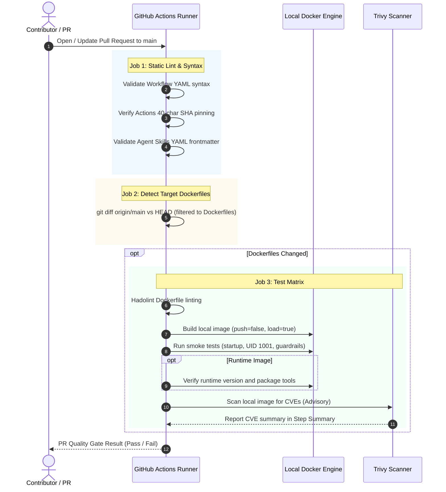
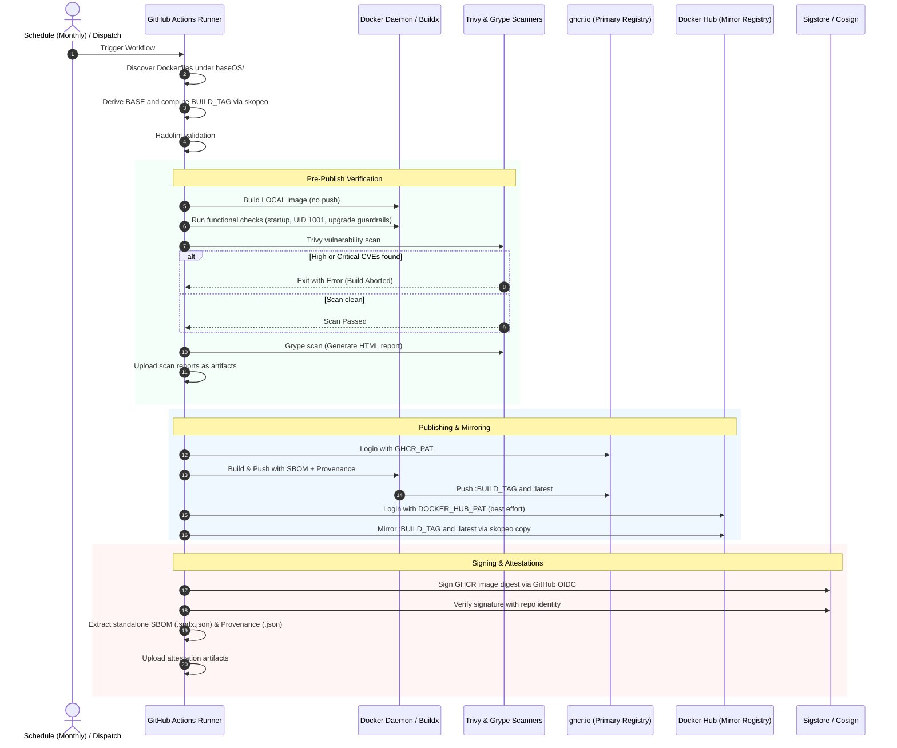
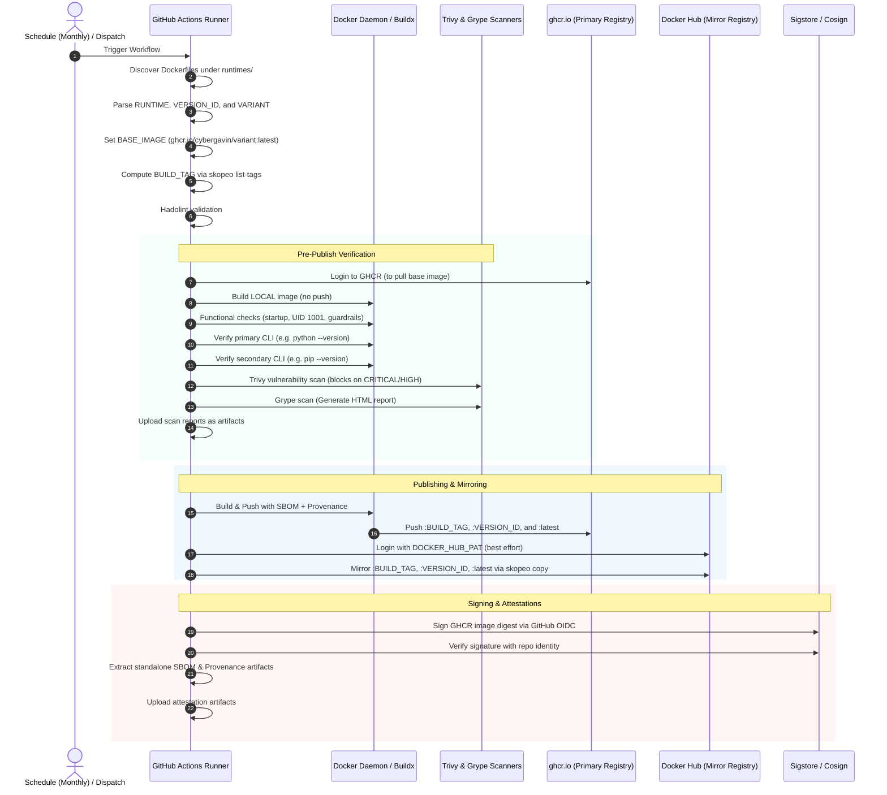

# CI/CD Workflows

This document describes the automated GitHub Actions pipelines powering image testing, security scanning, publishing, and supply chain attestation across this repository.

---

## Workflow Overview

| Workflow | File | Triggers | Scope | Key Outputs |
| :--- | :--- | :--- | :--- | :--- |
| **PR Validation** | [`.github/workflows/validate.yml`](../.github/workflows/validate.yml) | `pull_request` (targeting `main`), `workflow_dispatch` | `baseOS/**`, `runtimes/**`, `.github/workflows/**`, `.agents/**` | Static checks, local test builds, functional smoke tests, Trivy scan |
| **BaseOS Release** | [`.github/workflows/baseos-build-publish.yml`](../.github/workflows/baseos-build-publish.yml) | Schedule (`0 10 1 * *`), `workflow_dispatch` | `baseOS/**` | `ghcr.io/cybergavin/<base>` + Docker Hub mirror, Cosign signatures, SBOM/provenance artifacts |
| **Runtime Release** | [`.github/workflows/runtime-build-publish.yml`](../.github/workflows/runtime-build-publish.yml) | Schedule (`0 10 1 * *`), `workflow_dispatch` | `runtimes/**` | `ghcr.io/cybergavin/<runtime>-<variant>` + Docker Hub mirror, Cosign signatures, SBOM/provenance artifacts |

---

## 1. PR Validation Workflow (`validate.yml`)

Runs strictly with read-only permissions (`contents: read`) to validate changes before merging into `main`. No secrets, image pushes, or remote mutations occur.

---

## 2. BaseOS Build & Publish Workflow (`baseos-build-publish.yml`)

Builds hardened BaseOS images (`almalinux`, `alpine`, `amazonlinux`, `wolfi`), signs them with keyless Cosign via OIDC, and mirrors them to Docker Hub.

---

## 3. Runtime Build & Publish Workflow (`runtime-build-publish.yml`)

Builds language runtime images (e.g. `python-wolfi`) inheriting from published Cybergavin BaseOS images.

---

## Security Invariants Across Pipelines

1. **Gate before Push**: No remote image is ever published or mirrored without first passing local container smoke tests and Trivy vulnerability gates.
2. **Keyless Signing**: Images are signed using GitHub Actions short-lived OIDC tokens through Sigstore Cosign—no long-lived private signing keys are stored in repository secrets.
3. **Supply Chain Attestation**: Every published image embeds both an in-toto provenance attestation (`mode=max`) and an SPDX Software Bill of Materials (SBOM), and publishes standalone JSON artifacts to the workflow run.
4. **Action Pinning**: All third-party GitHub Actions are pinned to full 40-character commit SHAs to protect against upstream supply chain compromise.
